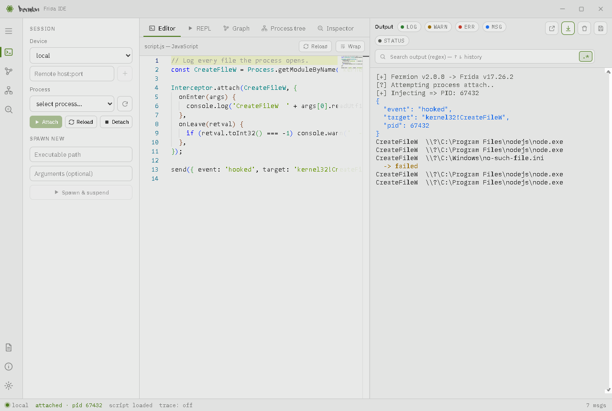
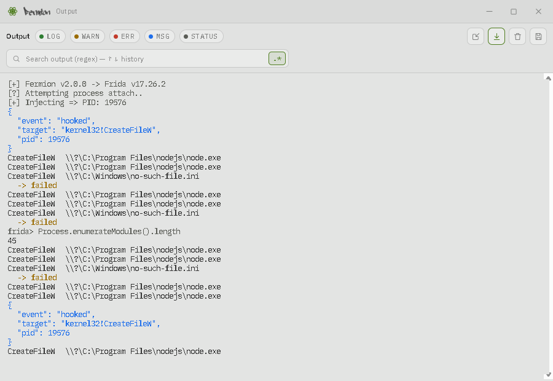
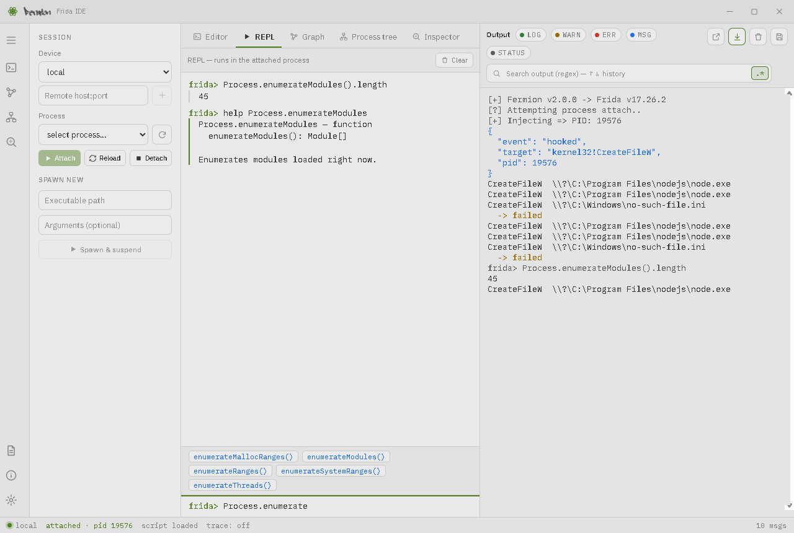
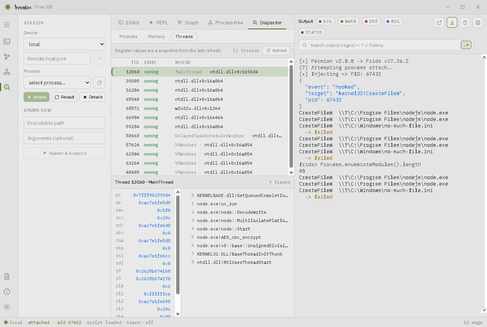
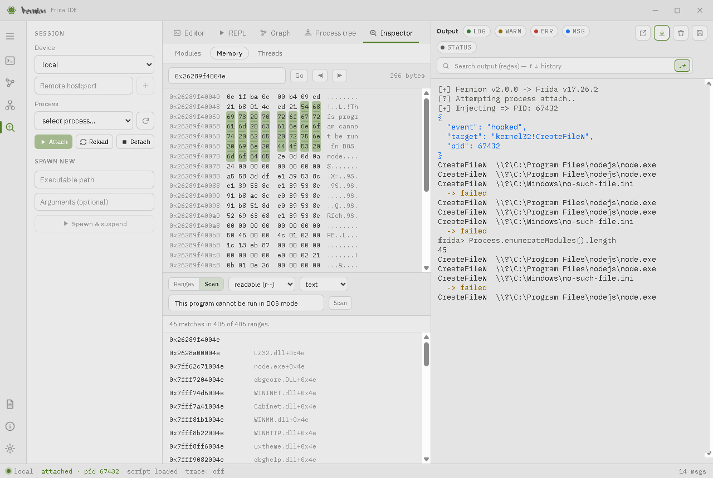
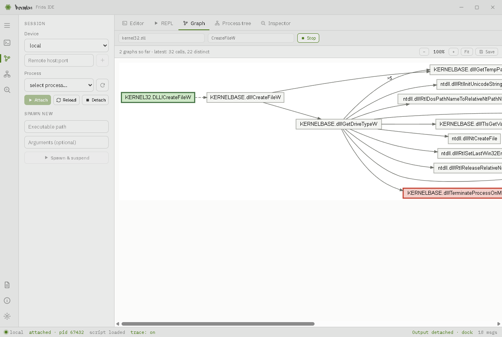
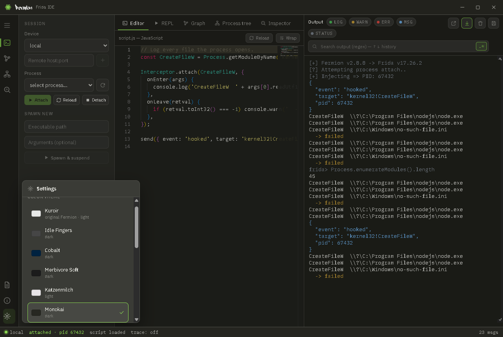

     

# Fermion

Fermion is a desktop IDE for [Frida](https://frida.re). It wraps [frida-node](https://github.com/frida/frida-node) and the [Monaco editor](https://microsoft.github.io/monaco-editor/) in an Electron app, so you can write a Frida script, inject it into a process, and watch its output in one window. Around the editor it adds a live REPL, a process tree, a read-only inspector for the target's modules, memory and threads, and a call-graph tracer.



> **Maintained fork.** This is [@watson0x90](https://github.com/watson0x90)'s maintained continuation of the original [FuzzySecurity/Fermion](https://github.com/FuzzySecurity/Fermion) by [Ruben Boonen (@FuzzySec)](https://twitter.com/FuzzySec), with full credit to the original author. Version 2 rebuilds the app on a secured main/renderer split with a React interface (Electron 45, Frida 17, Monaco 0.57).

`What's in a name`: A fermion can be an elementary particle, such as the electron, or it can be a composite particle, such as the proton. Fermions include all quarks and leptons, as well as all composite particles made of an odd number of these, such as all baryons and many atoms and nuclei.

## Contents

- [Get Fermion](#get-fermion)
- [A first session](#a-first-session)
- [The window](#the-window)
- [Editor](#editor)
- [Output](#output)
- [REPL](#repl)
- [Hooks](#hooks)
- [Process tree](#process-tree)
- [Inspector](#inspector)
- [Graph](#graph)
- [Remote and USB devices](#remote-and-usb-devices)
- [Keyboard shortcuts](#keyboard-shortcuts)
- [Themes](#themes)
- [Writing scripts for Frida 17](#writing-scripts-for-frida-17)
- [FAQ](#faq)
- [Development](#development)
- [Notes](#notes)

## Get Fermion

### Releases

Pre-built packages for x64 Windows, x64 Linux and arm64 macOS are on the [releases](https://github.com/watson0x90/Fermion/releases) page.

### Run from source

Clone the repository, then from the `Fermion` folder:

```
npm install
npm start
```

`npm start` builds the interface first (`npm run build`) and then launches the app.

> Frida 17's Node bindings ship **N-API prebuilds**, so a plain `npm install` fetches a binding that works inside Electron. The old `npm_config_runtime=electron` / `npm_config_target=...` environment variables are no longer needed. A recent Node.js is recommended; it is only used to drive `npm` and the build.

### Build a package

After the steps above, build a standalone package with [`@electron/packager`](https://github.com/electron/packager):

```
# Windows
npx @electron/packager . --icon ./src/images/fermion-ico.ico

# Linux
npx @electron/packager . --icon ./src/images/fermion-ico.png

# macOS (arm64)
npx @electron/packager . --platform=darwin --arch=arm64 --icon ./src/images/fermion-ico.icns
```

On Apple Silicon an unsigned app is blocked from launching, so ad-hoc sign the bundle before running it: `codesign --force --deep --sign - Fermion-darwin-arm64/Fermion.app`.

## A first session

1. In the **Session** sidebar, leave **Device** on `local`, open the **Process** list and pick a process. (Or find it in the [Process tree](#process-tree).)
2. Write a script in the **Editor**, for example:

   ```js
   // Log every file the process opens.
   const CreateFileW = Process.getModuleByName('kernel32.dll').getExportByName('CreateFileW');

   Interceptor.attach(CreateFileW, {
     onEnter(args) {
       console.log('CreateFileW  ' + args[0].readUtf16String());
     },
   });
   ```

3. Press **Attach**. Fermion attaches to the process and loads the script; what it prints appears in **Output**.
4. Edit the script and press **Reload** (in the Editor toolbar or the sidebar, or `Ctrl-T`) to load the new version without detaching.
5. Press **Detach** when you are done.

To start a program under Frida instead of attaching to a running one, fill in **Spawn new** in the sidebar (executable path and optional arguments). The process is started suspended, the script is loaded, and then it is resumed, so hooks are in place before its first instruction runs.

## The window

| Area | What it is for |
|---|---|
| **Title bar** | Drag to move the window; minimize, maximize and close on the right. |
| **Rail** (far left) | Switches the toolbox tab, and opens the Frida API reference, About and Settings. The top button expands it to show labels. |
| **Session sidebar** | Device and process pickers, Attach / Reload / Detach, and Spawn new. |
| **Toolbox** (centre) | Tabs: **Editor**, **REPL**, **Hooks**, **Graph**, **Process tree**, **Inspector**. |
| **Output** (right) | Everything the script prints, with filters and search. Can be detached into its own window. |
| **Status bar** | Device, attached PID, whether a script is loaded, trace on/off, message count. |

## Editor

The Monaco editor with Frida's type definitions loaded, so you get completion, signatures and inline documentation for the Frida API as you type.

The toolbar shows the script's file name (hover for the full path), with a dot beside it while there are unsaved changes. A script that has never been saved is `untitled.js`.

- **Open** (`Ctrl-O`) and **Save** (`Ctrl-S`). The first save asks where; after that, Save writes back to the same file. **Save as** always asks.
- **Recent** (the clock) lists the last ten scripts you opened or saved. A file that has since been deleted is reported and dropped from the list.
- Opening a file while there are unsaved changes asks before discarding them.
- **Reload** loads the editor's current text into the attached process. A script that fails to load (a syntax error, say) is reported in Output.
- **Wrap** toggles line wrapping.

Saving the Output log or a graph does not change which file the script is saved to.

## Output

Output shows what your script produces, coloured by kind:

| Chip | Comes from |
|---|---|
| **LOG** | `console.log` / `console.info` / `console.debug` |
| **WARN** | `console.warn` |
| **ERR** | `console.error`, and errors thrown by the script |
| **MSG** | `send(...)` payloads (objects are pretty-printed) |
| **STATUS** | Fermion's own lines: attach, reload, detach reason |

- Click a chip to hide or show that kind. Hidden lines are kept and come back when you turn the chip on again.
- **Search** starts as you type and highlights the first match. `Enter` goes to the next match and `Shift+Enter` to the previous one; `Esc` or the × clears it. The `.*` button switches between regex and plain-text search. `↑` / `↓` in the search box recall earlier searches, which are remembered between sessions.
- The four buttons at the top right are **detach**, **follow tail** (keep the newest line in view), **clear** (`Alt-C`) and **save** (write the output to a text file).
- The last 5,000 lines are kept.

### Detaching Output

The detach button moves Output into its own window, which is useful on a second monitor; the toolbox then takes the full width of the main window. Dock it again with the dock button in that window, by closing that window, or with the "Output detached · dock" link in the main window's status bar. History, filters, the follow setting and the colour theme carry over both ways.



## REPL

A `frida>` prompt that evaluates JavaScript in the attached process.



- `Enter` runs the entry; `Shift+Enter` adds a line. `↑` / `↓` recall earlier entries.
- `Tab` completes the name at the cursor: a global (`Proc` → `Process`) or a member (`Process.enumerateMod` → `Process.enumerateModules`). When several names fit, the part they share is filled in and the choices are listed: keep typing, click one, or move through them with `↑` / `↓` and accept with `Enter` or `Tab`.
- `help` explains the prompt and lists the Frida APIs available in the target. `help Process` shows Frida's documentation for it and the members that exist in this process; `help Process.enumerateModules` shows the full signature and description. `?Process` works too. The text is Frida's own, taken from its type definitions at build time.
- Results are printed as JSON where that makes sense, and Frida values such as `NativePointer` print as themselves. Entries and results are also copied to Output; help text is not.

Things to know:

- The REPL runs in **its own scope**, separate from the script in the Editor. It cannot see that script's variables, and it keeps its own across script reloads.
- Only `var` declarations (and assignments to undeclared names) persist between entries. `let` and `const` do not.
- A running entry can be stopped with **Cancel** (or `Esc`), and one that has not finished after **20 seconds** is abandoned automatically. Either way the REPL is restarted, which clears its variables. A busy loop may keep running in the target until you detach.
- Completion only follows plain dotted names. It will not complete after a call or an index (`foo().ba`, `arr[0].x`), because that would mean running your code just to make suggestions.

## Hooks

Hook functions in the attached process without writing a script.

1. Type part of a function name and press **Find**. `module!function` narrows it to one module, and `*` matches anything (`kernel32!CreateFile*`). An address (`0x7ff…`) or `module!0x1a2b` names one exact place.
2. Choose where to look:

   | Search in | Finds |
   | --- | --- |
   | **Exports** | Functions that modules export. |
   | **Imports** | Functions a module imports. Here the module in `module!function` is the one doing the importing, so `app.exe!*` lists everything `app.exe` calls in other modules. |
   | **Debug symbols** | Functions named in debug symbols, exported or not. |

3. Press **Hook** on a result, or **Add all** for every result listed (50 at a time).

Each hook is a row with a switch, its state, and how many times the function has been called. Select a hook to see two views:

- **Calls** lists what the hook logged: the time, the thread, `→` on entry and `←` on return, indented by call depth. Click a line to see where the call came from. Callers inside a module are named; addresses that belong to no module (JIT code, or values the unwinder mistook for return addresses) are counted on one line. **All hooks** shows every hook's lines together, and **Output** chooses whether the lines are also printed in the Output pane as `[hook] name -> …`.
- **Handler** is the JavaScript that runs for that hook. Change it and press **Apply** (`Ctrl-Enter`); the new handler is used from the next call, and one that does not compile is rejected while the hook carries on with the old one.

A new hook starts with a handler that prints the first four arguments and the return value:

```js
({
  onEnter(log, args) {
    log('(' + args[0] + ', ' + args[1] + ', ' + args[2] + ', ' + args[3] + ')');
  },
  onLeave(log, retval) {
    log('=> ' + retval);
  }
})
```

`log(…)` adds a line to Calls. `args[n]` and `retval` are pointers, so read what they point at (`args[0].readUtf16String()`, `retval.toInt32()`), and `retval.replace(x)` changes what the function returns. `this` is shared between `onEnter` and `onLeave`, so a value saved on entry is there on return. Everything in the [Frida API](https://frida.re/docs/javascript-api/) is available.

Things to know:

- Hooks live in their own helper script, so reloading or changing the script in the Editor does not remove them.
- Hooks are remembered by module and offset. After a detach they wait, and are placed again when you attach, including to a new run of the program where the module sits at a different address. They are not yet saved when Fermion closes.
- A hook on a very busy function cannot flood Fermion: lines are delivered in batches of at most 200 every 100 ms, and the rest are counted as *dropped*. The call count stays exact. Switching **Callers** off in the Handler view makes a busy hook much cheaper.
- A handler that throws is reported as a red line, and the target carries on.
- There can be up to 200 hooks.

## Process tree

The processes on the selected device as a parent → child tree, so you can tell which `chrome.exe` is which.

- **Filter** by name or PID. Parents of a match stay visible for context.
- Click the arrow on a row to collapse or expand its children.
- **Attach** from a row with its button (shown on hover) or by double-clicking it. This does the same as Attach in the sidebar.
- The attached process is highlighted. **Only ancestry** narrows the tree to that process, its parents and its children.
- **Refresh** re-reads the list. A device that does not report parent PIDs gets a flat list and a note saying so.

## Inspector

Views of the attached process that only observe it. Nothing in the Inspector writes to the target's memory. Each view loads when you open it and again when you press **Refresh** or come back to it. **Auto**, on the Threads list and the Memory hex view, re-reads every 2 seconds while the view is open, which is handy for watching a buffer change.



**Modules** lists every loaded module with its base address and size. Select one to list its **exports** or **imports**, with a filter. Click any address to open it in Memory.

**Memory** has three parts:

- A **hex view** of 256 bytes. Type an address and press Go, or page with ◀ ▶.
- **Ranges**: the mapped memory ranges with at least the chosen protection (`r--`, `rw-`, `r-x`, `rwx`). Click one to view it.
- **Scan**: search those ranges for hex bytes (`4d 5a ?? 00`, where `??` matches any byte) or for text. Click a result to see it in the hex view with the match marked. A pattern needs at least two concrete bytes. A scan stops after 500 matches or 8 seconds and says so.



**Threads** lists each thread with its state and where it is. Select one for its register values and a backtrace with symbol names. Click a register value or a frame to open that address in Memory. Register values are a snapshot from the last refresh.

**Follow** (on a selected thread) uses Frida's Stalker to count the calls that thread makes. Press it, let the thread run, then press **Stop**: the functions it called are listed, most-called first, and clicking one opens it in Memory. Only one thread can be followed at a time, and a follow ends by itself after 15 seconds. Following is much heavier than the other views: the thread runs through instrumented copies of its code, so it is slower while followed, and, as with tracing, a fragile target may not tolerate it.

The menu beside **Follow** sets what is followed:

| Choice | What Stalker follows |
| --- | --- |
| **Follow everything** | All the code the thread runs. |
| **Skip system libraries** | Everything except modules under the system directories (`C:\Windows`, `/usr/lib`, `/System`, …). |
| **Only one module** | The module you name (suggestions come from the loaded modules), plus code that belongs to no module, such as JIT-compiled code. |

A call *into* code that is left out is still counted; what that code does inside is not. Leaving code out makes the thread run faster while it is followed and keeps the result to the code you care about. Code that a skipped library calls back into (a callback, for instance) is not seen either.

Above the result, **Filter functions** narrows the list by name, module or address, **By module** groups the functions under their modules with each module's call and function totals (click a module to open it), and the disk button saves the functions shown as a CSV file. Module totals count every function the thread called, including those beyond the 300 most-called that are listed.

An address outside every readable range is refused rather than read. That includes stack guard pages, which must not be touched.

## Graph

Traces one exported function and draws what it calls.



1. Enter a **module** and one of its **exported functions**. Both boxes suggest names from the attached process. The module can be left empty to look the function up across all modules.
2. Press **Trace**. Each time the function runs, the calls made inside it are drawn as a graph: a node is a function (`module!symbol`), an arrow is a call, and `×3` on an arrow means it happened three times. The traced function is green and the last function called is red.
3. Press **Stop** to end the trace.

Things to know:

- **Tracing replaces your script.** While a trace runs, the script from the Editor is unloaded and Fermion's tracer is loaded in its place. Stop reloads the Editor's script.
- A trace follows the thread that entered the function until it returns. Work the function hands to another thread is not shown, and two runs of the same function can produce different graphs.
- A function that is called very often is sampled (at most one graph every 0.75 seconds) rather than traced on every call, and a graph is cut off at 400 distinct calls and says so.
- Zoom with − and +, or press **Fit** to shrink the whole graph into the pane. **Save** writes the graph as an SVG file.
- Tracing uses Frida's Stalker, which is heavy. It can slow the target noticeably and, as with any tracing, can destabilise it.

## Remote and USB devices

The **Device** list shows the devices Frida can see: `local`, and USB devices or emulators running `frida-server`.

To reach a `frida-server` over the network, type its address in **Remote host:port** under the device list (for example `192.168.1.20:27042`, or just the host for the default port) and press the + button or `Enter`. It is added to the device list and selected. Selecting another device removes it again.

## Keyboard shortcuts

| Keys | Action |
|---|---|
| `Ctrl-S` | Save the script |
| `Ctrl-O` | Open a script |
| `Ctrl-T` | Reload the script into the attached process |
| `Alt-C` | Clear Output |
| `Tab` (REPL) | Complete the name at the cursor |
| `Enter` / `Shift+Enter` (REPL) | Run the entry / new line |
| `↑` / `↓` (REPL, Output search) | Earlier / later entries; in the REPL, move through listed completions |
| `Esc` (REPL, while an entry runs) | Cancel the entry |
| `Esc` (Output search, REPL completions) | Clear / dismiss |

On macOS use `Cmd` in place of `Ctrl`. `F5` and `Ctrl-R` are disabled on purpose: reloading the window would drop the session.

## Themes

Open **Settings** (the gear at the bottom of the rail) to choose a colour theme. There are 16, light and dark, and each one restyles the whole app: editor, Output, panels and window frame. The default, Kuroir, is the original Fermion look. The choice is remembered.



## Writing scripts for Frida 17

Fermion ships Frida 17, which removed some long-standing APIs. Scripts written for older versions need small changes:

| Older scripts | Frida 17 |
|---|---|
| `Module.findExportByName('kernel32.dll', 'CreateFileW')` | `Process.getModuleByName('kernel32.dll').findExportByName('CreateFileW')` |
| `Module.getExportByName(mod, sym)` | `Process.getModuleByName(mod).getExportByName(sym)` |
| `Module.findExportByName(null, 'malloc')` | `Module.findGlobalExportByName('malloc')` |
| `Module.findBaseAddress(mod)` / `Module.getBaseAddress(mod)` | `Process.findModuleByName(mod).base` / `Process.getModuleByName(mod).base` |
| `Memory.readUtf16String(p)`, `Memory.writeU32(p, v)`, … | `p.readUtf16String()`, `p.writeU32(v)`, … |

The `Java`, `ObjC` and `Swift` bridges are also no longer built into the Frida runtime, so `Java.perform(...)` is not available to a plain script loaded here. A script that needs a bridge has to be bundled with it first (see `frida-compile` in the Frida documentation) and the bundle loaded into Fermion.

The scripts in [`Examples`](Examples) have been updated to the Frida 17 export-lookup API. Several of them depend on a specific Windows build or target program, as their headers say.

## FAQ

### Windows

  * **Q**: I need to inject a SYSTEM level process, how can I do that?
    * **A**: Fermion needs to run as Administrator with `SeDebugPrivilege`. Launch PowerShell as Administrator and start Fermion from there. Running Fermion itself as SYSTEM (for example through psexec) has caused Electron to freeze since Electron 8.

### Linux

  * **Q**: I can't attach to a running process?
    * **A**: The kernel's ptrace restrictions usually block it; the error appears in Output. Run Fermion or the Frida server as `root`, or relax the restriction with `sudo sysctl kernel.yama.ptrace_scope=0`.

### General

  * **Q**: My old script fails with `TypeError: not a function`.
    * **A**: It most likely uses an API that Frida 17 removed. See [Writing scripts for Frida 17](#writing-scripts-for-frida-17).

  * **Q**: Why can't the REPL see the variables in my script?
    * **A**: Every Frida script has its own JavaScript scope, and the REPL is a separate script from the one in the Editor. Define what you want to explore at the prompt, or have your script `send()` or `console.log` it.

  * **Q**: I want to build Fermion against a newer Electron or Frida. Do I need to match a specific Electron prebuild?
    * **A**: No. Frida 17's Node bindings ship runtime-agnostic N-API prebuilds, so bump the versions in `Fermion/package.json` and reinstall.

  * **Q**: Where do the editor's type definitions, the REPL's `help` text and the Docs window come from?
    * **A**: All three come from `node_modules/@types/frida-gum/index.d.ts`, so they describe the Frida that is installed. The index behind `help` and the Docs window is generated from it during `npm run build`.

  * **Q**: Tracing made the target slow or unstable.
    * **A**: Call tracing is resource intensive. Fermion samples hot functions and caps the size of a graph, but tracing a function that does a great deal of work can still stall or crash a process. Prefer narrower functions.

## Development

Fermion is an Electron app with a strict split between its two halves:

- **Main process** (`Fermion/core.js`, `Fermion/src/frida-service.js`): owns Frida and every privileged operation.
- **Renderer** (`Fermion/src/ui`, React + TypeScript + Redux Toolkit): the interface. It runs with `contextIsolation` on and `nodeIntegration` off, and reaches the main process only through the `window.fermion` bridge defined in `Fermion/src/preload-api.js`. Frida operations go through one allow-list in `Fermion/src/frida-ipc.js`.

The renderer shows text produced by the process being instrumented, so it is treated as untrusted: arguments are validated in the main process, and target-supplied strings are never inserted as HTML.

Fermion's own helper scripts, which run inside the target, live in `Fermion/src/tools`: `repl-agent.js` (REPL), `hooks-agent.js` (Hooks), `inspector-agent.js` (Inspector) and `trace.js` (Graph).

From the `Fermion` folder:

| Command | What it does |
|---|---|
| `npm run build` | Bundles the interface and generates the REPL help index |
| `npm run watch` | Rebuilds the interface on change |
| `npm start` | Builds, then launches the app |
| `npm run typecheck` | TypeScript check |
| `npm run lint` | ESLint |
| `npm run test:unit` | Component tests (Vitest) |
| `node --test src/*.test.js` | Main-process and agent unit tests |
| `node scripts/ui-smoke.js` | Launches the real app and checks that it renders |
| `node scripts/ui-test-*.js` | End-to-end tests that drive the real app (terminal, toolbar, dialogs, editor files, detach, process tree, REPL, hooks, inspector, graph, attach) |
| `node scripts/docs-screenshots.js` | Regenerates the screenshots in this README (Windows) |

The end-to-end tests that attach to a process report `SKIP` where the operating system forbids attaching, which includes GitHub's Linux runners. They run in full on a machine that can attach.

### Cutting a release (maintainers)

Releases are intentional and maintainer-driven. Pushing a version tag runs [`.github/workflows/release.yml`](.github/workflows/release.yml), which builds Windows, Linux and macOS (arm64) packages, launches each one to check that it starts and renders, and publishes a GitHub release with the zipped artifacts:

```
# bump "version" in Fermion/package.json, commit, then:
git tag v2.0.0
git push origin v2.0.0
```

## Notes

### ChangeLog

Version-by-version changes are in the [changelog](CHANGELOG.txt).

### Call to action

If Fermion is useful in your work, pull requests, bug reports and feature requests are welcome.

### Roadmap

* ~~Implement a more complete device manager interface.~~
* ~~UI re-design.~~
* ~~More native tools built on top of Fermion~~ (REPL, Process tree, Inspector).
* ~~Follow a thread with Stalker from the Inspector.~~
* ~~Cancel a running REPL entry.~~
* Android and iOS scripts: bundle the Java and ObjC bridges, which Frida 17 no longer builds in.

### Special thanks

* [Ruben Boonen (@FuzzySec)](https://twitter.com/FuzzySec), who created Fermion.
* [Ole André V. Ravnås](https://twitter.com/oleavr) for Frida, and for his patience answering questions about Frida, NodeJS and Monaco.
* [mattahan](https://www.deviantart.com/mattahan), whose Buuf icon is used for the Windows package.
* @MiscMisty, @lez0sec and @berkayyildi for contributing time and code to Fermion.
